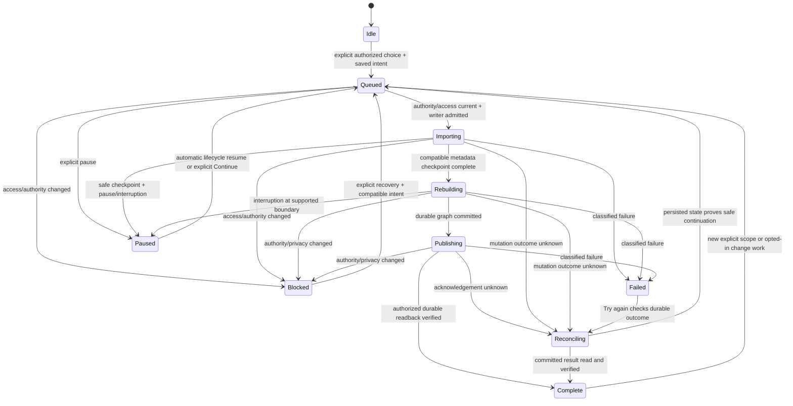

# Automation, persisted state and lifecycle

This companion defines CAP-1 through CAP-4 and CAP-6/CAP-7/CAP-11. The records
and state names below are proposed contracts, not assertions of existing APIs.

## Independent state domains

Do not collapse onboarding, photo access, active history authority and job status
into one `onboardingComplete` boolean.

| Domain | Minimum meaning | Persistence / ownership |
| --- | --- | --- |
| First-run presentation | Schema version; untouched, started or entered-Atlas disposition; updates-offer version/dismissal | App-local private settings; independent of Auth identity and owner content |
| Source intent | Explicit library vs exact-picker choice, active record/source generation and permitted scope; no implicit consent from OS grant | Owner-scoped private job/source storage, never generic route parameters |
| Photo authorization | Current full/limited/denied/unavailable plus whether another system prompt is allowed | Reinspect through the adapter; do not treat cached permission as authority |
| Active history | Existing local/account authority pointer, owner/session/access and privacy fences | Existing record-context and durable lifecycle; not set by a setup marker |
| Preparation run | Run identity, scope generation, phase, committed checkpoint/revision, run intent and explicit pause | Existing import/reconstruction persistence plus minimal compatible extension |
| Recurring updates | Explicit current preference and actual registration/check state | Existing maintenance repository/scheduler; separate from initial import |

Persist no copied raw photo library or raw error payload in these records. Selected
handles stay in owner-private storage only when supported and safe to persist;
their absence after restart means selection recovery, not permission to scan all.
Apply the existing backup/privacy policy; do not claim encrypted SQLite or E2EE.

## Startup resolution

Resolve the versioned marker, existing durable record/job and current active
authority before selecting the default route or displaying private content.

1. Honor an explicit valid destination after its existing authorization checks.
   It must not start imports, request permission or switch owners implicitly.
2. If the marker says entered Atlas, or durable pre-existing history/import
   checkpoints or persisted disconnected/deleted lifecycle prove established use,
   open Atlas. Migrate legacy presentation
   state idempotently without creating consent, reconnecting or enrolling updates.
3. If the marker is started but no access choice/skip completed, reopen the
   access-choice surface. A picker cancellation/denial does not count as import.
4. Otherwise show Welcome. `Not now` records entered Atlas without read intent.
5. A failed marker/history/bootstrap read is a recoverable startup error. Never
   infer fresh install, initialize over an unreadable DB, or show another owner.

An externally granted OS permission without a prior Travel Life processing intent
does not start a first import. A deleted/disconnected record remains under the
existing explicit create/reconnect flow; presentation-state migration cannot
recreate it. Signing out or deleting a history does not reset first-run display
or silently restart source processing.

## Run state machine

`Complete` describes a verified finished generation, including a valid empty
result. Empty and sparse are result projections, not job errors. `Paused` stores
its cause: explicit user pause never takes the automatic-resume transition.
`Blocked` requires remediation or an existing authorized lifecycle recovery;
do not repeatedly retry revoked access. Reconciliation can remain unresolved
with **Check again**; the diagram does not imply eventual success.

## Admission and permission-to-work handoff

1. A tap immediately acknowledges pending action before any awaited call.
2. Record a private action/run identity and requested mode. Invoke only that mode's
   native boundary. For library access accept the current actual grant; for picker
   require a non-canceled nonempty response. No read before the authorized choice.
3. Validate active record and scope, save the minimal run intent/checkpoint, then
   replace setup with Atlas. Storage failure retains an actionable setup surface.
4. Start work from a provider/service above route lifetime. Do not start via a
   screen effect that re-runs on focus, mount, Fast Refresh or a new renderer.
5. Reinspect permission before reading. Use the existing writer transaction gate
   and maintenance coordination. A waiting run shows activity; do not add a
   competing SQLite connection/lock manager or call a timeout a rollback.
6. After metadata completion, call the existing rebuild and durable-read pipeline
   once. Do not trigger a second rebuild merely because Atlas mounted.

No mandatory count-only traversal precedes metadata import. Refactor the current
`requestBroad` count coupling while retaining permission inspection. Count from
actual processing or an inexpensive supported total; an unavailable denominator
must not delay useful work.

## Scope and ownership invariants

- A run binds to the active local/account authority, lifecycle/source generation,
  exact selected set or current library-scope boundary and expected revision.
  These are private domain guards, never diagnostic fields.
- Full and limited OS grants authorize only currently accessible assets. Missing
  assets in a limited set are not source deletion. Exact picker import never
  calls broad enumeration, even if the OS already grants full access.
- A picker item without a stable/reusable identity is not invented as durable
  evidence. Keep supported items, classify unavailable items in private coverage,
  and present an honest zero/partial result; do not silently copy all originals.
- Revalidate identity/access before each new read page and before publishing.
  Source changes stop new reads immediately and invalidate obsolete callbacks.
  Already committed storage is reconciled through existing privacy rules.
- Signout, account/replica switch, consent withdrawal, disconnect and deletion
  fence old callbacks and UI publication. A late native success cannot activate
  history in a different record or resurrect a removed source.
- At most one admitted run owns work for the same active record/source generation.
  Duplicate taps, startup and scheduler events join/observe that work or report
  expected already-running; they never start a second native writer.
- Existing correction overlays, exclusions, home bases, manual journeys and
  Replay draft/commit remain authoritative. This feature does not regenerate or
  overwrite them to simplify onboarding.

## Resume, pause and retries

| Event | Required behavior |
| --- | --- |
| Navigate to Settings/journey | Continue eligible work; preserve screen and task state |
| Background / interruption | Checkpoint at supported boundary; mark interrupted honestly; no completion promise |
| Foreground / relaunch | Inspect persisted run, permissions and authority; resume compatible interrupted intent once without a new confirmation |
| Explicit **Pause** in Details | Stop scheduling new pages after current safe transaction settles; preserve checkpoint and pause across restart |
| **Continue** | Reinspect scope/authority and reconcile checkpoint; changed scope uses compatible recovery, never blindly replays old pages |
| Picker handles cannot be recovered | Offer **Choose photos** for a new explicit set; never substitute library import |
| Repeated foreground events | Coalesce, do not restart a full scan or graph rebuild |
| Safe transient read failure | At most two automatic retries at 1 s and 3 s while foreground and guards unchanged |
| Backgrounded during retry delay | Stop the timer; persisted work can be reconsidered on eligible foreground |
| Unknown native write outcome | Inspect durable checkpoint/revision/receipt before retry; unknown is not failed/rolled back |
| Nonretryable schema/constraint or access failure | Stop automatic retry; show the mapped recovery; retain saved content |
| Explicit destructive control | Apply existing confirmation, native fences and cleanup contract; no new automatic recovery |

Retry defaults are engineering assumptions, not measured performance. A writer
busy result does not prove another writer's identity. Safe reads may retry;
mutations require existing idempotency and reconciliation before any repetition.
An unresolved publication read can retry the read without reimporting metadata.

## Progress and publication

- Report known current-stage completed/total work only when both values describe
  the same current scope/generation and measure actual finished units. A stale
  cached library count is not the denominator for a changed selection.
- Label a measured percentage as its phase, such as **Reading photos · 42%**.
  If the library changes or the denominator loses validity, switch to an
  indeterminate bar rather than invent growth or clamp to false completion.
- Do not allocate made-up weights to import, rebuild and readback. Change the
  short label as the real phase changes. Import 100% is never overall-ready 100%.
- Publish the first graph only after the existing completed import/rebuild and
  durable authorized read. No partial page-derived lifetime map is added here.
- A still-authorized previous Atlas remains available during work; removed or
  blocked content follows existing fail-closed rules, not a blanket keep-old-UI rule.
- Lazy thumbnails, supported page loading and current preview caches can prepare
  in the background of navigation. Do not eagerly decode the whole library or
  render Replay video at first publication.

## Recurring updates and account boundaries

Initial processing can run after explicit photo choice without a separate Start.
Recurring library work still requires its explained preference. Register only
after eligible completed import and opt-in. Preserve existing opt-ins, scheduling
restrictions, foreground catch-up and bounded worker checkpoints. Existing enabled
maintenance can reconcile permitted changes; a presentation marker cannot enable it.

This increment need not build a headless initial-import service. Mandatory
continuity is independent screen lifetime, safe interruption and foreground
resume, plus the existing explicitly enabled OS maintenance route. Observe real
background scheduling on Android/iOS separately from developer-triggered handlers.

Account entry reuses current services and feature gates. Sign-in alone does not
enroll a device, attach local evidence, enable sync, upload media, apply a restore
or replace the active local record. An owner who requests restore uses the
existing explicit consent/activation flow; only its verified pointer swap opens
the account Atlas. Preserve offline access and owner/session fences. This spec
neither resolves existing OTP/service acceptance gaps nor changes M6/M7 protocols.

The automatic native photo-choice handoff operates on the connected local record.
From an active account Atlas, route **Add photos** through existing explicit
source enrollment/consent or an explicit switch to the separate local record;
do not import native library rows directly into an account replica. Local-only
copy must never conceal an account operation. Existing enrollment may continue
only under its already persisted authorization and current account gates.
