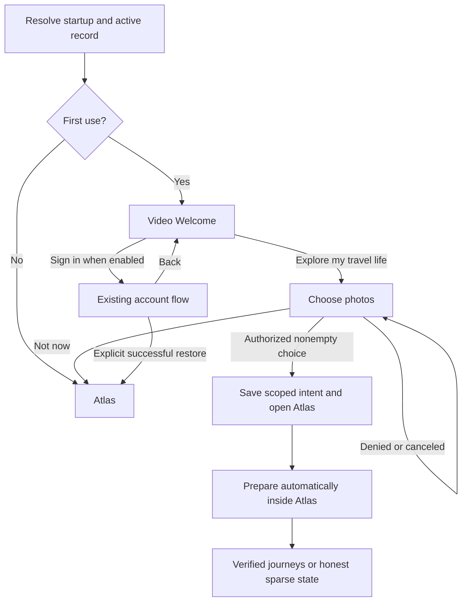

# Experience, navigation and copy

This companion specifies CAP-1, CAP-2 and CAP-4 through CAP-10. Product copy is
English; labels below are the default, not a new localization project.

## Reference and deliberate change

Use the approved video Welcome, access-choice, import-progress, Atlas,
sparse/declined and recovery patterns in the Living Atlas design system.
Keep colors, typography, quiet controls, safe areas and media provenance.
The scoped change combines Trust with access choice and places preparation
inside Atlas. The prototype's separate progress screen is not another required
navigation stop. Do not copy its simulated data or progress.

## First-use path

OS permission/picker interactions add platform-dependent taps. The normal
successful path requires exactly two app-level decisions: begin, then choose
access. No separate Continue, Import, Build or View Atlas follows a successful
choice. Do not wait for the whole library to be counted before opening Atlas.

## Screen contracts

### W — Welcome

- Retain the existing montage, headline and single citrus primary action,
  **Explore my travel life**. Keep **Illustrative footage** visibly associated
  with the montage, play/pause, reduced motion and the still fallback.
- Remove the extra introductory prose block below the hero; retain essential
  information through the access/privacy surface. The primary action is visible
  at normal text size without scrolling, with scrolling available for large text.
- If account entry is enabled, show a quiet **Already have an account? Sign in**
  link. Hide it when the account capability is disabled; do not enable a flag.
- Opening Welcome neither requests permission nor starts media scans, imports,
  uploads or renders. Existing account-session verification is not a media scan
  and remains governed by the account service; do not claim zero network traffic.

### A — Choose photos

One short surface replaces the standalone Trust and technical Import screens:

| Element | Baseline copy / behavior |
| --- | --- |
| Title | **Find your journeys in your photos** |
| Explanation | **Choose the photos Travel Life can read. We'll build your Atlas on this device.** |
| Primary | **Use photo library** — uses the OS authorization prompt; accepts full or limited access |
| Secondary | **Choose some photos** — uses the supported explicit picker |
| Quiet exit | **Not now** — opens Atlas without starting work |
| Disclosure | **Privacy & details** — access purpose, source coverage and processing limits |

The disclosure explains that originals stay at source, accessible metadata is
processed locally, photo location alone does not prove presence, cloud-only media
may be missing, and this action does not authorize upload, cloud AI or sharing.
Necessary purpose and the automatic-build consequence stay in the main explanation.
Do not imply that the OS must grant full access or hide the selected-photo path.

On successful permission/selection, immediately acknowledge the action, validate
and persist scoped intent, and replace setup routes with Atlas. Processing is
owned above screens. If intent persistence fails, remain here with **Try again**;
permission may already be granted, so retry must not prompt again unnecessarily.
Picker cancellation keeps this surface with no error alert and no automatic scan.
A zero-item selection remains here with **Choose photos** as its next action.

When opening access from an existing Atlas, show the current source scope briefly.
Back/dismiss returns to that Atlas context; there is no detour through Welcome.
The automatic local flow applies to the active local record. From an account
Atlas, **Add photos** opens the existing account source/enrollment consent path
or offers an explicit switch to the separate local record. Do not reuse the
local-only explanation while attaching evidence to an account. Account login or
an active account replica does not grant native-library enrollment consent.
After denied access, offer the supported picker and **Not now**; show **Open
settings** only when changing OS settings is the useful supported recovery.
Do not repeatedly request denied access or promote limited access to full.

### H — Atlas, including preparation

- Atlas is the normal home, titled **Your Atlas**. Keep **Map / Timeline** and
  existing year controls as view/filter controls, not separate destinations.
- Header utility is a recognizable **Settings** control. Replace the current
  **Homes** shortcut as the only settings entry; Home bases remains a named row
  inside Settings. Retain **About**/coverage through a quiet details surface.
- While preparing, keep a compact progress strip below the header: stage label,
  progress bar and **Details**. Opening Details exposes pause/recovery/coverage;
  counts and technical stages do not appear as a multi-panel dashboard by default.
- Do not draw placeholder journeys. With no published history, retain the Atlas
  frame and a neutral preparation state. With a prior authorized record, retain
  it and show **Updating your Atlas…**. Never keep privacy-invalid old content.
- On first verified publication, reveal the supported map bounds once if the user
  is still in untouched initial Atlas. If the user chose Timeline, moved the map,
  changed a year or opened a journey, preserve that choice. Completion elsewhere
  may update a quiet status; it never pushes/pops a screen or steals focus.
- Ready Atlas exposes **Replay** as its task primary when eligible. Sparse and
  access-blocked states instead prioritize their recovery action. Existing mode
  and filter selected styles may remain; they are not competing task CTAs.
- **Add journey** remains reachable as a quiet contextual action, including empty
  Atlas. A selected journey opens a recognizable preview and the existing detail
  path; no new walkthrough is inserted.

### S — Settings and source management

Use four recognizable task rows with brief actual-state summaries. Open only the
chosen panel/destination rather than render all controls and explanations at once:

| Row | Contains |
| --- | --- |
| **Account & sources** | Existing account entry, consent, restore/source controls; local source access and **Add photos** remain usable without an account |
| **Home bases** | Existing home review, naming and removal controls |
| **Updates** | Explicit recurring-update preference, concise scheduling status, last successful check and manual **Check now** |
| **Privacy & data** | Existing hide/restore, disconnect and delete controls, with destructive confirmations retained |

This is a discoverability/layout change to existing controls. Do not weaken
deletion, correction or account security semantics. Detailed copy appears within
the selected task. Settings is reachable with one navigation action from Atlas;
each task row takes at most one more action to open its controls.

### U — Optional continued updates

After a completed eligible library import and after Atlas is usable, show one
nonmodal invitation: **Keep your Atlas up to date** / **Check for new photos when
your device allows.** Actions are **Turn on** and **Later**. It is secondary to
exploring the first result and does not intercept navigation.

Show it once per versioned offer; persist dismissal. A user can find Updates in
Settings later. Existing enabled/disabled preferences are retained. Do not offer
library-wide monitoring after only a one-shot picker selection; show its exact
source limitation in Updates. OS restriction means **Updates are limited by your
device**, not a false successful schedule. Push notifications are not added.

## State copy and recovery

Use one concise state message and one task primary action. A quiet secondary
escape may remain; do not stack the whole matrix into a screen.

| State | Main copy | Primary / secondary behavior |
| --- | --- | --- |
| No photos connected / skipped | **Add photos to discover your journeys.** | **Add photos**; quiet **Add journey** |
| Denied / not askable | **Photo access is off.** | **Choose photos** where supported, otherwise **Open settings**; **Not now** in setup |
| Revoked during work | **Photo access changed. Choose what to use next.** | **Review photo access**; preserve valid history under existing privacy policy |
| Permission/picker API unavailable | **Photo access isn't available here.** | **Add journey**; permission option omitted until supported |
| Discovering / importing | **Finding your journeys…** | Progress only; **Details** opens **Pause** |
| Reconstructing | **Building your Atlas…** | Indeterminate unless actual completed/total work is available |
| Durable result publication | **Finishing your Atlas…** | No success/100% label until durable readback succeeds |
| Explicitly paused | **Atlas preparation is paused.** | **Continue**; do not auto-resume |
| Safe lifecycle interruption | **Continuing your Atlas…** after automatic resume | If authorization is unchanged, no extra confirmation |
| Completed empty accessible set | **No photos were available in this selection.** | **Add photos**; quiet **Add journey** |
| Processed evidence, no supported journeys | **No journeys found from these photos yet.** | **Add photos**; quiet **Add journey**, coverage in Details |
| Partial but useful record | **From the photos available to Travel Life.** | Explore current journeys; **Add photos** secondary, no warning wall |
| Known retryable read failure | **Couldn't finish your Atlas. Your saved history is kept.** | **Try again** only when safe; never claim a save whose outcome is unknown |
| Mutation outcome unresolved | **Checking your saved progress…** | Reconcile automatically; expose **Check again** if unresolved, no blind rerun |
| Bootstrap/storage unavailable | **Couldn't open your Atlas.** | **Try again**; never show fresh setup or clear history |
| Map/style unavailable | **Map unavailable. Your journeys are in Timeline.** | **Open Timeline**; map retry secondary |
| Account entry temporarily unavailable | **Sign-in isn't available right now.** | **Continue on this device**; retry inside account flow |

Local thumbnails missing does not mean the journey is absent. Keep the row with
an honest media fallback. A completed zero-journey graph is distinct from a job
that failed, a revoked source or an unknown acknowledgement.

## Navigation and return contract

| Origin / action | Destination and return behavior |
| --- | --- |
| Fresh `/` | Resolve startup, then Welcome; no transient Atlas/private-content flash |
| Returning `/` | Replace with `/history`; never push Welcome underneath |
| Welcome primary | `/import` rendered as access choice; Back may return to Welcome before a successful choice |
| Successful access / Not now | Replace setup stack with `/history`; Android Back at Atlas follows normal app-root behavior |
| Legacy `/trust` | Compatibility redirect to access choice; no obsolete Trust page or new prompt on redirect |
| Existing `/import` entry | Access management in current context; no automatic scan just because route opened |
| Atlas → journey → album/edit | Return through the existing task hierarchy with acknowledged edit rules; retain filters, camera, selected journey and list position where still valid |
| Atlas → Replay | Existing private preparation/player; Back follows current render/edit guards and returns to Atlas context |
| Atlas → Settings → task | Back closes current task, then returns to Atlas context; Home bases is not the settings label |
| Welcome → account | Back returns to Welcome; sign-in success alone does not redirect or restore |
| Explicit account restore completed | Open Atlas for the verified activated account replica using existing consent/authority contract |
| Unknown or unavailable route | Safe **Back to Atlas** after bootstrap; fresh untouched users can return to Welcome |
| Explicit valid deep link | Honor its destination after authority/access checks; no forced onboarding detour or implicit permission |

Across in-session returns preserve only still-valid context. If a selected journey
disappears, clear that selection and retain the surviving filter/list context;
if its year has no items, show the honest empty filter and **All years**. Do not
silently switch filters just to manufacture a populated screen. Never persist
raw media URLs or private content inside generic navigation parameters.

Cold launch opens Atlas with safe persisted task progress, not arbitrary previous
editor/modal/player routes. An explicit current deep link has priority. Existing
account access denial switches/locks according to the account authority contract;
it must not flash another owner's record.

## Lean presentation and accessibility

- One title, at most one short explanation and one task primary action per state;
  secondary alternatives stay visually quieter. Do not hide essential purposes
  behind a tooltip. Necessary consent/destructive copy may be longer in its task.
- Use labeled familiar controls; icons supplement visible **Settings**, **Replay**,
  **Back** and **Details**, with accessible names and selected/disabled/busy states.
- Meet the design system's 48 px/platform-equivalent primary targets. Primary
  actions remain reachable with device safe areas, keyboard and large text; allow
  scrolling instead of clipping or shrinking essential labels.
- Announce major status changes politely; do not announce each imported item or
  repeatedly move screen-reader focus. Moving between screens gives focus to the
  new heading; background completion preserves current focus.
- Reduced motion replaces cinematic movement with a stable result. Loading and
  selected/error states never depend only on animation, sound or color.
