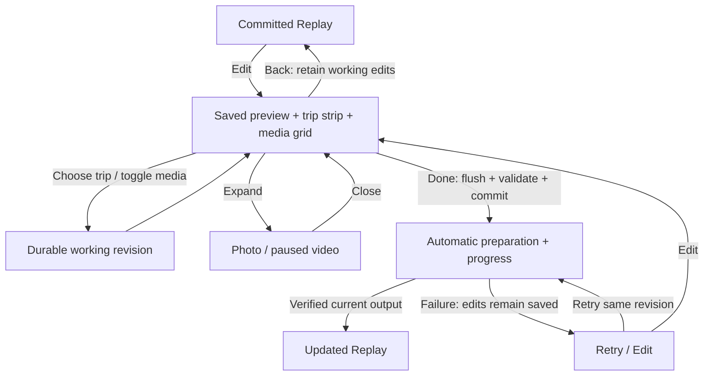

# Replay Edit experience and state contract

Derived 2026-10-24 from decision 0014 and the M4.7 memlog. This companion
expands CAP-5 and supersedes the flat button-list editor presentation. The
interaction contract still owns service/background behavior; timing and selection
contracts own frame budgets and automatic curation. The adopted soundtrack spec
owns music, player mute and month/year direction. Delivery remains in M4.7 D4.

## User task and references

The owner recognizes a trip, sees which memories appear in its Replay, changes
those choices and watches the result. Entry is optional: Replay still plays
without visiting Edit. Use `docs/product/design-system.md` and decision 0014 on
every build/rebuild. Reference `journey-media-viewer.tsx` for the paged local
gallery and inspect/return pattern, extending its missing video posters and
selection controls. Reuse Living Atlas matte surfaces, citrus action/selection,
quiet metadata and reachable controls; Atlas-only glass tokens do not spread here.

The normal task is Edit -> select trip if necessary -> toggle media -> Done.
Media inspection, ordering and soundtrack changes are optional, never required
steps. No technical preparation screen, replacement wizard or instruction wall.

## Screen composition

| Region | Content and behavior |
| --- | --- |
| Header | Back, `Edit Replay`; concise saving/failure status only when useful. |
| Preview | Compact 16:9 last-committed video or its safe poster, paused on entry. A short `Saved preview` label makes pending changes unambiguous. If none is ready, use a neutral preview placeholder, never invented owner imagery. |
| Trip strip | Horizontally virtualized covers and short labels/time. Clear active trip, inclusion state and accessible `Include trip` toggle. Selecting a trip only changes the grid; it does not implicitly exclude it or reorder chapters. |
| Current trip | Short title, `8 selected`, optional provisional duration, trip-scoped `Select all` / `Clear`. Duration is an estimate until validated clip durations/output are available. |
| Media grid | Recognizable photo thumbnails and video posters; selected checkmark/border, separate expand control, video badge and known duration. No per-tile stacks of Add/Replace/Move buttons. |
| Secondary controls | Compact `Order` and `Music` disclosures; `Reset edits` in overflow. `Order` exposes existing oldest/newest chapter direction and optional within-trip selected-media order. |
| Footer | Safe-area-aware, reachable primary `Done`. During a pending commit show `Saving…` and suppress duplicate submissions. |

Initial trip is the currently playing eligible trip; otherwise the last edited
eligible trip, otherwise the first in presentation order. The player/service
must supply current chapter identity; never guess from array position. If that
identity is unavailable, use the latter fallback. Selecting a trip does not seek
the saved preview implicitly. An explicit Play shows saved content; opening media
inspection pauses it. No simultaneous preview and inspector playback.

Default grid is three columns at normal phone widths. On short/landscape screens
collapse preview to a poster/header before sacrificing grid space. Large text may
reduce columns and wrap labels. Use one vertical virtualized grid, not a large
list nested in another scrolling screen; keep headers/footers integrated with it.
Main touch targets aim for at least 48dp, including the distinct inspect action.
Preserve visible media identity when fitting both targets; adjust tile size or
columns rather than layering tiny overlapping icons.

## Selection means output

Candidate album, chosen composition and working edits are different sets:

- Candidate membership comes only from the current policy-visible trip album.
- On entry, checkmarks use the effective committed chosen manifest, overlaid with
  a recoverable working revision. Do not initialize from every eligible candidate.
- Untouched trips remain automatic. On the first media-content edit in a trip,
  freeze its current effective chosen set as an explicit selection and apply the
  change. Unchosen candidates remain unselected; further taps modify this set.
  This prevents automatic backfill from undoing a visible exclusion.
- Explicit selections are stable through replan/restart. Newly attached media is
  browsable but starts unchecked in an explicitly edited trip. Untouched automatic
  trips may be curated again by the existing selector. Reset returns to Auto.
- Done must render every currently valid explicit selection and no explicit
  exclusion; the selector cannot silently drop keeps to fit an automatic budget.
  Added memories may extend chapter duration under the timing contract.
- Trip inclusion and media choices are separate. Excluding a trip retains its
  working choices for re-inclusion and hides it only from this Replay.
- An included trip with zero selected media uses the existing honest destination
  card rule. Never backfill it silently. If no trip is included, keep edits and
  disable Done with `Choose a trip to continue`.
- Identity is trip-plus-media attachment, independent of tile index, page and
  display-token regeneration. A shared asset in two trips has independent intent.

An unavailable explicitly selected item remains marked as selected intent, with
a warning badge and `Unavailable` state; it is not counted as render-ready.
Use `8 selected · 1 unavailable` when needed. Do not silently replace/drop it or
complete Done as if it rendered. Offer contextual removal/retry/access recovery.
Privacy-revoked media is immediately withheld, including thumbnails and labels;
only a safe aggregate changed-items notice may remain. Privacy always wins over
selection persistence. Unknown access is `Checking`, not an empty album.

## Direct actions and bulk scope

| Action | Result |
| --- | --- |
| Tap tile | Toggle inclusion once; immediate checkmark and count; enqueue ordered local working save. Never trigger an encode. |
| Expand tile | Open recognizable full-size local photo or paused video. Explicit Play starts video; Back/close restores the same trip, anchor and selection. |
| Select another trip | Restore that trip's scroll anchor and selection. Retain all other working choices. |
| Select all | Include all verified usable attachments in this trip's complete current album, not just loaded/visible cells. Preserve owner ordering; append new members in stable album order. |
| Clear | Set this trip to explicit empty media selection; keep trip inclusion and destination card. |
| Done | Flush working saves, revalidate, atomically commit once, return to player, automatically prepare changed output. |
| Back / native swipe | Retain working edits, return to committed player; no implicit commit, encode or export. If saving failed, retain editor and offer Retry or explicit Discard unsaved changes. |
| Reset edits | Confirm once, stage automatic defaults for the current Replay scope, clear explicit trip/media ordering and restore default direction/music. Done still applies; Back retains this working reset. Never change original media. |

Select all performs bounded complete-album accounting and access resolution with
a short progress bar; apply its result atomically against the captured album and
working revisions. Disable conflicting selection/Done only while that bulk action
settles; navigation/cancel remains available. Cancel, permission loss, incomplete
read, stale album or draft conflict preserves the previous selection and never
reports partial success. `Clear` uses the same revision semantics without decoding
every original. Both are reversible via a transient accessible Undo action, valid
until the next mutation/Done; Undo restores the exact previous trip intent.

Do not count an unknown/unreadable/cloud-only source as usable. No implicit
download or new permission prompt. Resolve access locally in bounded batches.
Bulk verification never means rendering or copying all originals. Show concise
unavailable counts when complete accounting justifies them, without an extra
confirmation step for ordinary selection.

## Inspect, order and soundtrack

Inspector is a single optional overlay. Swipe/browse stays within the current
trip's stable loaded/pageable album; selection controls use the same working
model, never a copied array. If scope changes while open, close/withhold the
affected item safely. Video pauses on close/background and is silent initially
for source inspection. This does not change the Replay soundtrack/player mute.

Within-trip ordering reveals a strip of selected thumbnails with accessible
Move earlier/later actions; drag is optional if achievable with existing native
capabilities. Movement cannot cross trip boundaries. There are no new manual
trip-order controls in this amendment: oldest/newest month-year ordering follows
the soundtrack spec, including stable same-month ties and unknown times last.

Music shows a short current-track label and replace/restore-default actions.
Native picker cancellation preserves prior working choice; invalid or >5 MB audio
gets fixed contextual recovery. Valid custom files are staged privately and owned
by the working revision until commit/discard; never delete a committed or leased
track while replacing a pending one. Follow the soundtrack companion for decode,
5,000,000-byte boundary and no-source-audio behavior. Speaker mute stays on the
player and does not change draft, rendering or export.

## Working save, commit and return

Working updates are serialized and recoverable independently of the committed
composition. Rapid taps have deterministic order and latest intent wins; a late
write cannot overwrite newer choices. Show immediate visual selection, but never
claim `Saved` before durable acknowledgment. App restart restores acknowledged
working edits and committed playback separately. Done waits for pending writes.

Commit uses compare-and-swap on working/base committed revision plus current
scope/source/privacy/lifecycle guards. Conflict retains the working version and
offers Reload/reapply; never overwrite the newer committed draft silently. Unique
successor remapping may restore intent; ambiguous mappings require owner resolution.

If there are no semantic changes, Done returns without re-rendering. Order-only
changes reuse safe chapter bytes where supported. A content change invalidates
affected trip output; soundtrack may require final audio assembly without
re-encoding unchanged visual chapters. Prior safe output remains leased until
replacement is ready; privacy-invalid output stops immediately. Never discard the
only valid preview before commit or successful replacement.

After successful commit but failed render, say `Changes saved. Replay couldn’t
update.` with Retry/Edit. Retry uses the same committed revision. Opening Edit
mid-preparation is allowed; Done coalesces to the latest revision. Return without
Done neither promotes working state nor seeds a share selection.

## Progress and concise recovery

| Work | Visible feedback |
| --- | --- |
| Page/thumbnail fetch | Cell skeletons/footer activity; usable loaded tiles stay interactive. |
| Bulk selection / working commit | `Checking media` or `Saving changes`, determinate only with a known denominator. |
| Resolve selected sources | Short `Getting your Replay ready`; indeterminate until exact work is known. |
| Compose | `Updating Replay · 42%` only for measured composition work, with progressbar accessibility values. |
| Output verification | Separate `Finishing Replay` phase; indeterminate if verification has no denominator. Playback begins only after success. |

Percentages are phase-local, monotonic within their job/phase and never simulated
with timers. On a new job/phase, label the transition; no unlabeled 100% -> 0% jump.
Rendering 100% is not total readiness. Announce phase changes and coarse progress
without reading every frame/tile. Background work follows OS scheduling and the
existing service lease, not a promise of uninterrupted execution.

Use fixed short recovery: `Couldn’t load photos` + Retry; `This trip changed` +
Reload; `Couldn’t save changes` + Retry; `Choose a trip to continue`; a contextual
unavailable notice. One brief `Only changes your Replay` hint is enough. No raw
errors, private paths/IDs, diagnostic dumps or persistent technical instructions.

## Scope and evidence limits

This is a media-inclusion editor with video context, not a trim/crop/effects,
clip-timing, multitrack or chapter-title editing suite. It changes no Journey List
membership, travel facts, corrections or shared snapshots. Existing separate,
empty-first sharing/review/consent remains required. No AI/dependency adoption,
media transfer or new telemetry is authorized by this spec.
