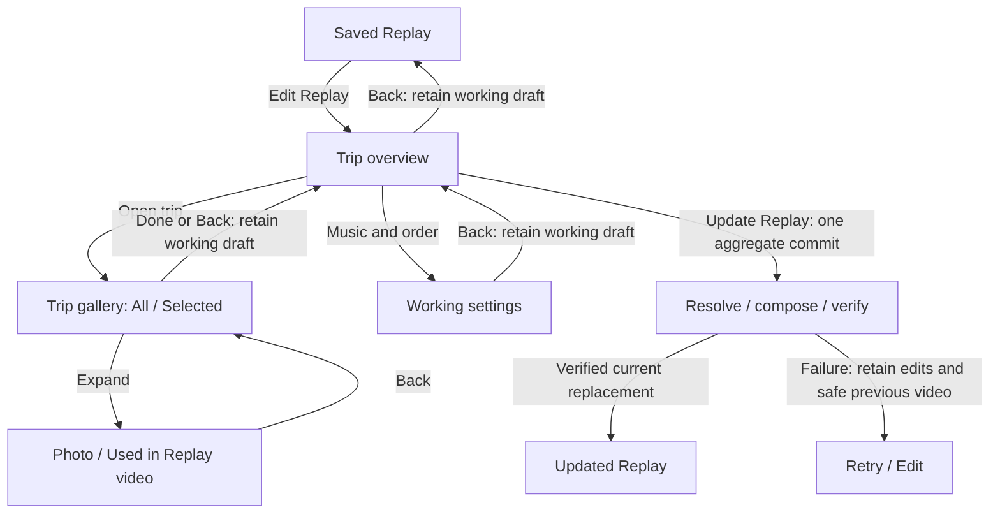

# Trip-first Replay editor

Derived from the owner-approved 2026-10-24 mock and canonical memlog. This is
CAP-5 / D4 in the existing M4.7 delivery. It supersedes the inline trip strip and
any instruction that trip-level Done commits or renders. Other selection,
inspection, audio, privacy, service and sharing requirements remain binding.

References: [Living Atlas](../../../docs/product/design-system.md), Journey List
See photos, [approved mock](../../party-mode/replay-edit-trip-first-2026-10-24.html).
The mock approves hierarchy/flow. Fictional totals, illustrations and timer-driven
progress are not production behavior. Its incomplete secondary actions and footer
shortcuts are completed by the contract below, not copied literally.

## Navigation and action scope

| Action | Required behavior |
| --- | --- |
| Player: Edit Replay | Pause saved video, open overview; revalidate and restore acknowledged working branch or committed composition. |
| Overview: open trip | Open only that trip; restore tab, scroll anchor and page state. First visit opens All even if zero selected. |
| Gallery: Done / Back / native Back or swipe | Wait for acknowledged trip working saves; return to the same overview position. No committed write or encode. Failed saves keep the gallery open with Retry or confirmed discard of unacknowledged edits. |
| Inspector: Back | Pause/release inspector; restore gallery anchor, tab and selection. |
| Settings: Back | Retain acknowledged working music/order; return to overview. |
| Overview: Back / native navigation | Flush/acknowledge pending work and return to saved player, retaining draft across restart. No implicit commit. |
| Overview: Update Replay | Flush writes, validate aggregate target, CAS-commit once and enqueue/join one idempotent preparation operation. |
| Update Replay without semantic changes | Disabled; defensive invocation reuses current verified output without encoding. |
| Repeated update / process restart | Join operation keyed by target committed revision; never create independent duplicate jobs. A later explicit update coalesces to the latest revision. |

No ordinary action needs a new confirmation. Confirm only intentional loss of
unsaved edits. No technical preparation wizard or sharing approval in Edit.

## Trip overview

- Fixed safe-area header: Back and Edit Replay. Keep saved-preview context in the
  player; no required large or autoplaying preview above the trip list.
- Virtualized trip rows: recognizable cover, permitted name, supported date,
  album total and selected count separately, e.g. `75 media · 6 selected`.
  Unknown counts use Checking media/selection, never zero. Loaded-thumbnail count
  is never the album total.
- Edited marks semantic working difference from current committed base, not
  visited/tapped/changed-and-undone. Included explicit-empty trip says Trip card
  only and remains navigable to its album.
- Row overflow: Exclude trip / Include trip. Exclusion retains choices and shows
  Not in Replay with inactive checks. Browse/inspect remains possible; content
  mutations require explicit re-inclusion.
- Searchable local Trips access for long histories; queries never leave device.
  Music & order is one overview entry rather than repeated gallery controls.
- Fixed footer primary Update Replay with concise save/update state. Disabled
  for no changes, unresolved selection/intervals/conflicts, failed or pending
  writes, incompatible running bulk work or zero included trips. Contextual
  recovery explains the current blocker. Zero selected media does not block a
  valid included trip-card-only chapter.

## Trip gallery

- Fixed Back / trip title / Done header; long titles wrap without pushing actions
  out of bounds. Done remains outside the scrolling grid.
- All and Selected tabs apply to this trip only. Selected pages authoritative
  chosen identities in composition order, even beyond loaded All pages. Returning
  to All restores its anchor; deselection retains focus on the next tile or the
  empty-state Browse all action.
- Recognizable photo/video grid; three columns by default, fewer as necessary
  for small widths/large text and distinct selection/expand targets. Video poster
  and duration badge, no grid autoplay or per-item text-button stacks.
- Fixed safe-area footer: selected count and honest chapter-length estimate or
  Calculating length. Unavailable selected intent is disclosed separately from
  render-ready count. Taps update immediately while durable saves run.
- Overflow holds Select all, Restore Auto, Clear, Undo; within-trip ordering is a
  contextual secondary view with accessible Move earlier/later. No six-button
  unwrapped horizontal row. Include trip is available for excluded trips.
- Fetching preserves candidate tile slots and usable loaded items. Initial/page
  failure has Retry; loaded content is retained. Near-end auto-prefetch has an
  explicit Load more recovery path. No empty gallery until complete empty read.

One virtualized list owns vertical scrolling. Fixed header/footer dimensions are
accounted for in viewport/padding, including system safe areas. Buttons wrap,
not clip; primary targets at least 48dp. Validate 320/360/390 logical widths,
landscape, large text and screen-reader focus. The mock is not this evidence.

## Shared album and count domains

Use a single repository primitive for effective album membership, corrections,
stable ordering and privacy for both See photos and Replay; do not duplicate SQL
or retain separate membership allowlists. Separate albumMember, replayEligible
and fixed ineligibility reason. A review surface may intentionally show rejected,
unassigned or moved-away evidence; this must not make it output-eligible. Hidden
data stays withheld, including labels/thumbnail/context. Retain undated members.

| Domain | Meaning |
| --- | --- |
| albumTotal | Policy-visible album members, null until authoritative. |
| eligibleTotal | Replay-eligible members, independent of preview readiness, null if unknown. |
| loadedCount | Metadata loaded for this gallery; never substitutes for albumTotal. |
| selectedIntentCount | Exact committed or recovered working chosen identities. |
| unavailableSelectedCount | Chosen intent currently unable to render, separately disclosed. |
| renderedCount | Actual identities in the verified output manifest, never a fresh Auto estimate. |

All shows permitted review-only members with inactive selection and concise
reason when allowed, so album totals remain intelligible. Bulk selection targets
eligibleTotal only. Scope differences require a fixed explanation, not exposure
of withheld data. Failure/unknown access never becomes zero or no photos.

## Paging, access and preview states

Proposed service/repository responsibilities; equivalent names allowed:

| Boundary | Input -> result |
| --- | --- |
| openReplayEditor | Opaque scope -> base/working revisions, trip summaries, composition identity/readiness; no lifetime original resolution. |
| readReplayTripPage | Session + trip + snapshot-bound cursor + limit -> stable opaque attachments, eligibility/access/thumbnail state, nextCursor/hasMore and nullable totals. |
| readSelectedTripPage | Same guards + composition revision -> chosen identities in order, independent of loaded All pages. |
| resolveReplayPreviews | Bounded visible/page keys -> revocable local handles and fixed availability outcomes; raw native references stay below provider. |

Initial page size 48 and at most two thumbnail/poster jobs are tuning defaults,
not measured performance or global caps. Page metadata for the active trip;
starting a later trip never depends on lifetime first-48 resolution. Prefetch
only bounded upcoming media. Resolve render originals only for selected output.

Cursors bind trip, album snapshot, stable sort and last attachment identity.
Deduplicate by stable trip-plus-media identity, never index. Late page/preview
results cannot overwrite another trip/session or resurrect revoked content.
Retain per-trip tab, page cache and anchor; handle lifetime is separate from draft
identity. Revoke handles immediately on privacy/lifecycle invalidation.

Separate access unknown/resolving/available/unavailable, thumbnail idle/loading/
ready/failed, eligibility and selected intent. Unknown candidates remain in All
before resolution. Tapping an unknown item marks a pending check and resolves
locally; adopt inclusion after usable resolution and preserve prior selection on
failure. Known eligible resolved items toggle immediately. Failed thumbnails
retry without treating the source as permanently missing. Never filter by
available=true before resolving/page enumeration.

Page failure keeps the prior cursor and shows Couldn't load more media + Retry.
Retry cannot skip/duplicate pages. A stale cursor refreshes/revalidates the album
and uniquely remaps working identities; it cannot attach stale data. Guard one
page request per session and permit cancelled/detached work to settle safely.
No implicit cloud download or fresh permission prompt on Edit entry.

## Authoritative composition and legacy artifacts

Keep committed owner choices, acknowledged working choices and verified output
manifest separate. Persist verified selection identities, actual order, validated
video intervals, manifest format, digest, scope/snapshot/policy/source versions,
soundtrack and renderer/selector versions beside the artifact. Stable private
trip-plus-media references stay in the repository; UI receives opaque session
keys. Persist neither source URIs nor transient display tokens nor share approval.

On opening Edit, committed checks/counts come from the current verified chosen
manifest; overlay a revalidated working branch bound to its base. For automatic
trips, displayed choices remain that composition until an explicit update/current
source replan. Preview resolution alone cannot change selection/counts or stale a
valid video. First content edit freezes only that trip's displayed effective set
as explicit. Owner exclusions cannot be auto-backfilled.

Legacy count-only cache: recover exact identities only from a validated stored
manifest/registry or independently verifiable existing identity payload. Validate
schema, versions, uniqueness and stable mapping under current policy. No guessing
from counts, labels, positional keys or a fresh Auto run. If unrecoverable, keep
the currently safe verified video playable; Edit shows Checking selection then
fixed Review selection/Retry. A clearly labelled proposed selection may be adopted
by the owner before editing; never present it as the existing video's checkmarks.
Only Update Replay can encode. Migration launches no render, clears no source
data and does not destroy the old safe file. Schema changes must be additive,
idempotent and layout-gated under the existing owner, using the discovered version.

## Working state, bulk actions and aggregate apply

Serialize saves under expected revision and freshness guards. Persist inclusion,
Auto/explicit mode, identities/order/intervals, soundtrack reference and direction.
Acknowledged working edits survive restart. Optimistic state is not Saved until
acknowledged; failed writes gate navigation/apply with Retry or explicit discard.

Select all reads/resolves the complete eligible trip snapshot, including unloaded
pages, with measured progress or indeterminate state for unknown totals. Atomically
select all verified usable members only after complete accounting; disclose known
unavailable/ineligible totals. Cancellation, incomplete read, stale album or CAS
conflict leaves previous choices intact. Cancel/navigation remains reachable,
settling bulk work before leaving. Clear stages explicit empty selection;
Restore Auto stages this trip's automatic set. Undo restores exact prior mode,
identity/order until next mutation or trip exit. Other trips, inclusion, music and
direction stay intact. No partial enumeration labelled Select all success.

Update Replay captures one immutable aggregate working revision after writes,
bulk and interval validation. Commit plus durable preparation intent is atomic;
native work occurs outside DB transactions. Operation identity prevents duplicate
jobs across taps/restart. Revalidate every selected member, including unloaded
ones. Unknown/failed explicit keeps require Retry/Remove/access recovery before
successful apply; no silently partial output.

Reuse current verified output for no semantic changes. Reuse unchanged safe
chapter bytes where supported; retain the existing chapter-reuse acceptance gate
if still unimplemented. Two changed trips produce one aggregate update request.
Working changes do not invalidate the old file. After commit, prior video may
remain a clearly labelled older preview only while current policy/leases permit;
never call it updated output. Privacy/access invalidation withholds stale pixels
immediately. Promote replacement only after verification and current-revision
checks; failure retains exact choices and safe old file with Retry/Edit. Retry
uses the same committed revision unless a new aggregate update supersedes it.

Conflict recovery retains working intent. Reload refreshes base; Use mine/latest
resolves current competing fields via CAS; Choose again opens the affected trip.
Only unique safe mappings reapply automatically. Unresolved intent blocks Update
Replay, not safe browsing or acknowledged navigation. Use mine cannot restore
withheld media. No raw error or stale private context enters recovery.

## Progress and retained boundaries

Page fetch, bulk selection, save, resolve, compose and verify have concise distinct
states. Numeric percentage requires actual denominator; unknown totals use a bar
without invented percent. Percent is phase-local; encoding 100% is not readiness.
Inspection shows actual version-bound Used in Replay interval, stops at its end,
and offers separate View original; original clip audio is excluded from output.
Music/order remain working until Update Replay; speaker mute changes listening
immediately without render. Sharing stays separate, empty-first, exact-previewed
and deliberately authorized. No trimming/effects/multitrack or membership editing.

E23-E40 extend existing editor acceptance. Owner-operated Bali/Taiwan comparisons
and unassisted Android/iOS two-trip editing are required; host fixtures/mock review
alone do not establish album completeness or device UX. Private evidence remains
local and untracked; no new provider processing/dependency adoption is authorized.
