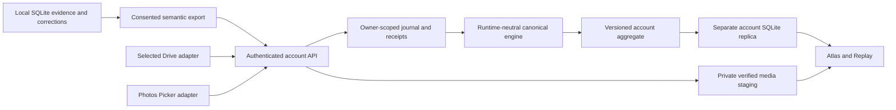

# Architecture spine: private multi-source history

## Design paradigm

Hexagonal domain: account/source HTTP adapters and native SQLite adapters consume
one runtime-neutral, versioned evidence/correction protocol. Local-only history
continues independently. A server aggregate is authoritative only for an opted-in
account replica, never for a pre-existing disconnected local record.

## Invariants and rules

### AD-1 [ADOPTED] Ownership and local continuity
**Binds:** all mobile data adapters and account actions.
**Prevents:** logging in switching ownership of existing private data.
**Rule:** Account data is keyed by verified owner and account generation. Local
data stays local until explicit consent/export. Account replicas use separate storage;
logout immediately hides account state and stops jobs without clearing local history.

### AD-2 Session isolation and live authorization
**Binds:** auth client, API gateway, SQL/object access.
**Prevents:** anonymous-session reuse or a revoked JWT continuing mutations.
**Rule:** Use a dedicated account client/storage key and verified non-anonymous
email identity. Every protected server action derives subject and session from
validated auth, checks the live session and account fence, and never trusts an owner
in the payload. Local signout uses explicit local scope. SecureStore persists bounded
chunks on native; web auth is memory-only in this mobile increment.

### AD-3 Canonical identifiers and transport
**Binds:** migration, native replicas and provider adapters.
**Prevents:** mismatched IDs/types or full-database replacement.
**Rule:** Only sync-contract.md version 1 DTOs cross the boundary. Evidence identities
are scoped by account/source/original local key; mappings preserve original lineage.
Coordinates/time are private consented fields; local-only types are not wire DTOs.
Schema incompatibility blocks activation; it never triggers data clearing.

### AD-4 Journal and atomic activation
**Binds:** sync requests, receipts, snapshots and engine worker.
**Prevents:** duplicate writes and stale partial history becoming active.
**Rule:** Requests carry independent mutation ID, expected account/source generation
and revision. A successful receipt and mutation commit together. Reusing an ID with
different content conflicts. Cursor reads are stable/versioned; aggregate activation
compares evidence/correction watermarks and engine version atomically.

### AD-5 [ADOPTED] Reuse actual reconstruction policy
**Binds:** canonical worker and mobile reconstruction.
**Prevents:** cloud grouping silently diverging from the local engine.
**Rule:** Extract runtime-neutral canonical v1.1/correction helpers from the current
native repository before use in workers. Run equivalence/permutation regressions;
do not implement a second simplified trip algorithm or change accepted parameters.

### AD-6 Reviewed facts, duplicate support and conflicts
**Binds:** deduplication, corrections, manual trips and rebuilding.
**Prevents:** inferred additions overwriting reviewed facts or copies inflating support.
**Rule:** Verify exact duplicate identities conservatively, retain source copies,
count one independent support unit per verified family. Corrections use expected
target versions and lineage scopes; conflicting changes remain proposals. Reuse
existing Needs review/fail-closed policies for ambiguous remaps. No wall-clock LWW.

### AD-7 Private derivatives and committed composition
**Binds:** media preparation/storage and Replay.
**Prevents:** public media exposure and screen-thumbnail-driven composition.
**Rule:** Explicitly authorized derivatives stage privately, are verified and then
activated with their manifest membership. Signed download URLs are transient, not
identity. Committed media order/group membership/soundtrack drives playback/export;
missing custom audio never causes silent substitution. Source-offline and cached
airplane-mode availability are distinct states.

### AD-8 Deletion fences precede cleanup
**Binds:** account/source/session controls, jobs, replicas and artifacts.
**Prevents:** an offline client or late worker resurrecting deleted data.
**Rule:** Advance a durable generation fence before purge, cancel/deny stale writers
and readers, then clean up idempotently. Disconnect stops new reads; remove-import
purges selected contributions under lineage rules; account-delete fences all account
data. Preserve independent owner facts and surviving duplicate sources explicitly.

### AD-9 Operational separation and enablement
**Binds:** config, environments, diagnostics, workers and deployment.
**Prevents:** a test/demo triggering private egress or claiming service readiness.
**Rule:** Separate account and sync feature config; fail closed when absent. No
runtime auto-deployment, implicit upload on login or service-role key in mobile.
Production requires region/destination, SMTP/template/rate limits, retention/backup
deadlines, quotas and actual platform/service verification. Use the existing closed
diagnostic contract; default provider request/body logging must be reviewed too.

## Brownfield seed

### AD-10 Snapshot authority and queue ownership
**Binds:** initial migration, restore, foreground/background sync and worker.
**Prevents:** M6 restore requiring M7 merge or retries creating new operations.
**Rule:** First compatible semantic snapshot is the initial restore authority;
subsequent source snapshots are acknowledged pending contributions until the M7
canonical worker activates a combined aggregate. Receipt, source snapshot and
active aggregate revisions have distinct namespaces. Persist outbox mutation identity
before send; one owner/source/generation-scoped lease coordinates foreground and
background, checkpointing only acknowledged work. Platform scheduling has foreground
catch-up. Session/source/consent fences are checked on every resume.

### AD-11 Offline access and residual capabilities
**Binds:** account replica, media URLs, rendering and removal controls.
**Prevents:** promising immediate removal of offline or already-issued bytes.
**Rule:** A previously accepted, locally unlocked owner may read its offline replica;
no offline server authorization or new transfer is implied. Explicit signout, account
switch or an observed session/account/source fence hides that context immediately
and queues affected cache cleanup. Issued object URLs can remain usable until their
five-minute expiry; offline copies cannot be remotely wiped immediately. Final render
activation/export rechecks current policy and rejects late stale results.

| Existing technology | Installed version | Role |
| --- | --- | --- |
| Expo | 57.0.31 compatible range | Native app and scheduling |
| React Native | 0.86.3 | Native UI |
| Supabase JS | 2.95.3 | Managed OTP/session and backend transport |
| Expo SecureStore | 57.0.4 compatible range | Native credential adapter |
| Expo SQLite | 57.0.4 compatible range | Existing v37 local store; separate account replica |

Versions are ratified from apps/mobile/package.json/lock; no upgrade is required.
Auth behavior is verified against official Supabase/Expo docs in
verification-and-operations.md. PostgreSQL migrations and functions are supplied
locally first; hosted destination and active service configuration are not assumed.

## Deferred decisions

- M8/M9 provider-specific job schemas/scopes are fixed by their own implementation
  stories after current provider checks; they must use AD-1 through AD-9.
- Paid storage economics, E2EE and original backup require new product direction.
- Real production region and backup lifecycle are enablement gates, recorded before
  private transfer; they do not change wire identity or the offline replica protocol.
