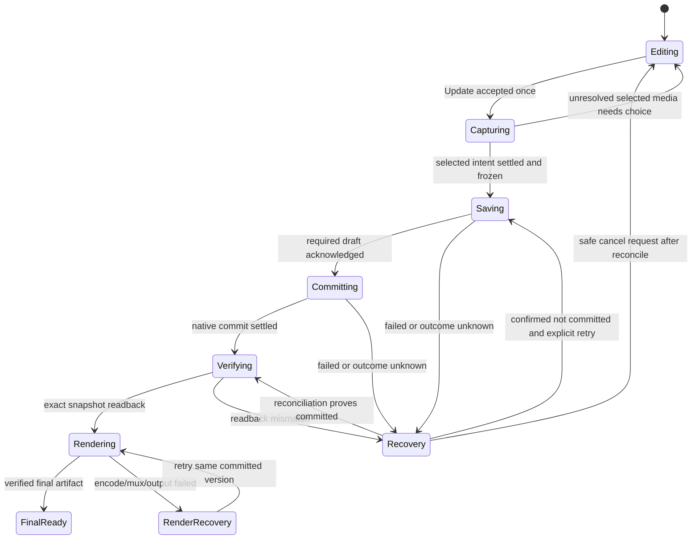

# Experience and state contract

Decision basis: CAP-1–CAP-8; D-01–D-04, D-11–D-17, D-21–D-27. Labels below are intended English app copy; user-facing planning discussion may be Vietnamese. Keep Living Atlas components and palette.

## Model and navigation

Four values must remain distinguishable: visible working intent W, durably acknowledged draft A, committed composition C and verified rendered version R. W may be newer than A; C may be newer than R. Never label W saved merely because a file copied or a debounce elapsed.

| Surface/action | Required behavior | Persistence/render consequence |
| --- | --- | --- |
| Atlas → Replay | Play verified current cache, otherwise prepare automatically | Hydrate editor metadata separately; no mandatory Edit/setup |
| Watch → Edit | Open overview with recoverable working draft, else committed composition | No render; retain valid previous video |
| Overview trip body | Open that trip's All gallery | Retain trip/filter/scroll anchors |
| Overview selected count | Open that trip's Selected view | Count is chosen composition, not loaded thumbnails |
| Overview include checkbox | Toggle presentation inclusion independently of opening trip | Keep that trip's media choices for re-inclusion |
| Gallery tile | Toggle selection immediately; mark unresolved selected intent explicitly | Queue draft change; no encode |
| Gallery Inspect | Open recognizable media without changing selection | Video paused/muted; show actual used interval |
| Gallery Done/header Back/system Back | Apply current trip intent to session and return immediately | Background save continues; no acknowledgement wait to navigate |
| Overview Back/system Back | Return to prior eligible Watch; preserve session/draft | Resume acknowledged changes after restart; no commit/render |
| Settings open | Clone music/order into a sheet subdraft | No shared working mutation yet |
| Settings Done | Apply valid subdraft once and close | Queue one complete working snapshot; no commit/render |
| Settings Back/gesture/system dismiss | Cancel sheet generation and discard unapplied settings only | Previously applied working media/music remain |
| Update Replay | Accept once, capture pending selected intent, save/commit/readback/render | One aggregate immutable replacement |
| Watch Share | Open separate empty-first selection for current verified committed output | No draft export or publication implied |

Hardware Back first closes Inspect or overflow, then cancels a settings subdraft, then applies gallery return, then overview return. `beforeRemove` and explicit header actions call the same navigation action; prevent double interception. Fullscreen Back closes fullscreen and retains listening state.

The session lives above the Replay screen, within the connected private-record lifecycle. Leaving the route cannot clear a debounce timer and abandon its promise. It remains owned until acknowledged/discarded; active render/source handles remain owned until settlement. On disconnect, immediately hide invalid content and prevent future output promotion, then drain/clean native work safely.

## Screen composition

**Overview:** fixed `‹ Back · Edit Replay`; recognizable trip rows with cover, concise name/month, selected count, inclusion check and open chevron. Excluded rows say `Not in Replay` and keep a reachable Include action. A checkbox is not nested inside the row Pressable; each has its own accessible target. Group same-name trips by displayed month as needed. Preserve local trip jump/search for long histories; query stays on device.

**Gallery:** fixed `‹ Back · trip · Done`, then `All N / Selected N / …`, then virtualized grid. Three columns normally, two when accessibility text/width requires. Show duration badge on video and a separate Inspect target. Selection is visual, accessible and independent from preview decoding. Preserve an honest selected count and chapter length in the safe-area footer; no long per-item labels.

More holds trip-scoped Auto, Select all, Clear, Undo and secondary ordering. Existing accessible Move earlier/later remains supported; no replacement flat media-button list. Trip Auto changes only that trip and retains global order/music. A separately labelled global reset, if retained, restores automatic choices and oldest-first while keeping applied custom music.

**Settings:** fixed `‹ Back · Music & order · Done`; one current track row/checkmark, `Choose audio file`, `Use default`, two-option oldest/newest selector. Show `Up to 5 MB` beside the chooser, not a technical preparation page. Display chosen basename locally; never the full URI/path. Errors stay next to the chooser.

**Watch/render:** keep existing player controls, dedicated speaker/fullscreen row and separate Edit/Share. An older eligible verified video can remain visible as `Previous Replay` while replacement is pending. The status belongs to the update being created; never imply the visible old pixels contain new choices.

## Save status and primary action

Save state and Update state are orthogonal; a pending autosave is not a reason to hide the Update action.

| Save state | Short status | Permitted actions |
| --- | --- | --- |
| clean | No extra copy | Edit; Update disabled because unchanged |
| dirty / saving under 2 s | `Saving…` only where needed | Navigate, continue edits; Update accepts request |
| queued/running ≥2 s | `Still saving…` | Navigate; continue edits unless update barrier active |
| queued/running ≥8 s | `Not saved yet` | Navigate; `Check again` for unknown running outcome; Retry only for definitely not committed failure |
| saved | Optional transient `Saved` | Update if W differs from C |
| definitely failed | `Not saved · Retry` | Continue editing or Retry latest snapshot; no render before success |
| same-scope revision conflict | `Draft needs review` | `Keep my choices` / `Restore saved Replay`; no auto-overwrite |
| privacy/generation invalid | `Trips changed · Refresh` | Preserve intent for safe review; reload current scope; no stale output |

`Check again` only reconciles; it must not enqueue a second native mutation. If native work is still unresolved, remain truthful and keep navigation enabled. A permanently stuck native operation remains an open recovery problem; never show success or silently advise data deletion/reinstall.

Update is disabled only when unchanged, no included trips, initial metadata is not ready, mandatory conflict/privacy review is unresolved, or an Update request already owns the barrier. Selected/bulk tasks already in flight can be captured by the Update request; related pending work shows preparation rather than requiring the owner to guess when to tap. All-excluded state says `Choose a trip`. Included trip with zero media remains a valid trip-card-only chapter under current renderer contract.

## Aggregate Update state machine

On acceptance, synchronously disable content mutations for the capture/commit boundary, retain navigation, snapshot the current intent sequence and capture every prior selected/bulk task. Late resolutions can only settle that captured task; they cannot mutate a newer session. No ordinary thumbnail request participates in this barrier. If selected access cannot resolve, show the affected choice with Retry/Keep editing; never silently omit it. Resume editing after an explicit failure/cancel at a safe boundary. While successful replacement renders, Watch shows progress and prior playback; Edit/Share of the new version remain gated until final verification, preserving existing finalization rules.

Known-work progress uses completed/total from actual work; unknown work uses indeterminate progress and a short activity label. Timeouts are recovery transitions, not fabricated 100% progress.

## Audio subdraft lifecycle

`picker → candidate → bounded private copy → decode validation → ready → Done → session intent → durable draft → committed render`. Show filename promptly after picker returns; checkmark means validated private file ready, not durable Replay saved. A local-valid file may be ready while shared draft save is pending.

Done during copy/validation records one apply request and shows short busy state; it closes after local validation, without waiting for SQLite. Back cancels this request and invalidates late file callbacks. Unreadable/zero/unknown-size/oversized/undecodable selection preserves the previous valid track. Keep an accessible Back throughout; canceling a native operation can invalidate its result without pretending the native work stopped.

Use default and order are also sheet-local until Done. Settings Back never rolls back trip edits made elsewhere. Acknowledged music applied by an earlier Done is retained by overview Back. If a retained custom file is missing, show `Choose audio file` / `Use default`; do not claim it is ready or silently replace it.

## Recovery and destructive boundaries

- `Keep my choices`: explicitly rebase the visible complete intent against a freshly validated same-scope draft, using current CAS only after that choice. Scope changes require refresh/review instead.
- `Restore saved Replay`: one confirmation because it discards all working edits. Freeze mutations, invalidate queued tasks/timers, reconcile active writes, reset working branch, read back committed composition, then publish it. No callback can revive the discarded branch.
- Cancel Update before native start: withdraw safely and retain W. After start, invalidate UI promotion if needed but reconcile before another mutation. Cancel render does not undo an already committed composition; preserve the exact version for retry.
- Closing a route keeps service-owned pending intent. Explicitly discarding an unacknowledged session must reconcile writes first. OS termination can lose W newer than A; do not promise otherwise.
- Privacy revocation/lifecycle disconnect immediately hides stale media/old playback and withholds sharing. Replay presentation exclusion alone does not revoke original trip/media access.

## UI acceptance boundaries

Validate 320/360/390/430 px, large system text, VoiceOver/TalkBack, safe areas, reduced motion and landscape/fullscreen. At least 44-point effective targets, no overlap between selection/Inspect, no clipped Done/Update, one vertical scroll owner. Header trip names wrap/truncate accessibly without pushing actions away. Run the end-to-end owner task without verbal coaching; screenshots alone cannot demonstrate intuitive navigation.
